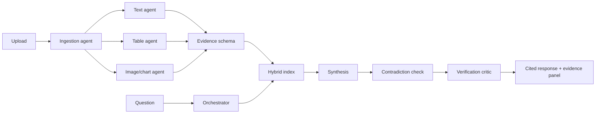

# EvidenceLens

> Ask questions across documents, images, charts, and tables — and receive answers grounded in inspectable evidence.

EvidenceLens is an open-source multimodal RAG MVP for analysts, researchers, students, auditors, journalists, and operations teams. It turns a small evidence bundle into normalized, searchable records, then answers questions with citations, confidence, contradiction warnings, and a visible workflow trace. It is deliberately more than a generic chatbot: provenance is part of the response contract.

## Why multimodal RAG?

Important decisions are rarely written in one paragraph. A report may explain a trend, a spreadsheet may contain the exact row, and a chart may reveal whether the visual agrees. EvidenceLens keeps those modalities distinct while making them retrievable together. If visual evidence is ambiguous, the system says so instead of inventing a precise value.

## MVP and Version 0.2 features

- Upload multiple PDF, TXT, Markdown, CSV, XLSX, PNG, and JPG files.
- Preserve page, sheet, row, column, source, and image metadata.
- Use deterministic hybrid lexical retrieval with modality filtering.
- Selectively route text, table, visual, and comparison modes based on the query.
- Produce structured answers with citations and evidence items.
- Detect possible conflicting numeric claims and surface uncertainty.
- Verify no-evidence and missing-citation cases.
- Use a safe, offline mock mode for tests and demos; provider settings are environment-based.
- Provide a browser UI and JSON API with inspectable evidence cards and safe image previews.
- Run locally with one test command and package with Docker.
- Version 0.2 adds an optional OpenAI-compatible multimodal analyzer with bounded retries, timeouts, and deterministic fallback.

Supported inputs: `.pdf`, `.txt`, `.md`, `.csv`, `.xlsx`, `.png`, `.jpg`, `.jpeg`.

## Architecture



### Agent responsibilities

| Agent | Responsibility |
| --- | --- |
| Orchestrator | Classifies the query and selects only relevant retrieval modes. |
| Ingestion | Validates, routes, and isolates parser failures. |
| Text extraction | Extracts TXT/Markdown/PDF text and page provenance. |
| Table/spreadsheet | Extracts CSV/XLSX rows with sheet and cell-range provenance. |
| Image/chart | Captures visual metadata and conservative uncertain descriptions. |
| Multimodal retrieval | Ranks lexical matches and filters by content type. |
| Evidence synthesis | Drafts from retrieved evidence only and attaches citations. |
| Contradiction | Compares numeric claims and warns about possible mismatches. |
| Verification/critic | Checks evidence presence, citations, and uncertainty. |
| Formatter | Returns answer, findings, citations, confidence, warnings, limits, and workflow events. |

## Installation

Requires Python 3.11–3.13. The checked-in `.python-version` pins the intended runtime family. Docker is optional.

```bash
python -m venv .venv
# Linux/macOS
source .venv/bin/activate
# Windows PowerShell: .venv\Scripts\Activate.ps1
python -m pip install -r requirements-dev.txt
```

All application dependency versions are pinned in `requirements.txt`; development versions are pinned in `requirements-dev.txt` and summarized by `requirements.lock`.

## Configuration

Copy `.env.example` to `.env` when using Docker or a model-backed adapter. Mock mode is the default and needs no key.

| Variable | Meaning | Default |
| --- | --- | --- |
| `MODEL_PROVIDER` | Provider adapter name | `mock` |
| `MODEL_NAME` | Model identifier | `deterministic-evidence-model` |
| `MODEL_BASE_URL` | Optional OpenAI-compatible base URL | empty |
| `MODEL_API_KEY` | Optional provider key; never commit it | empty |
| `EMBEDDING_MODEL` | Embedding adapter name | `local-token-overlap` |
| `MAX_UPLOAD_MB` | Per-file size limit | `25` |
| `TOP_K` | Retrieved evidence limit | `8` |
| `MODEL_TIMEOUT_SECONDS` | Per-attempt multimodal request timeout | `20` |
| `MODEL_RETRIES` | Bounded provider retry count | `2` |
| `MODEL_MAX_OUTPUT_CHARS` | Maximum stored visual description length | `2000` |
| `MOCK_MODE` | Offline deterministic behavior | `true` |

To enable the optional provider adapter, set `MOCK_MODE=false`, choose `MODEL_PROVIDER=openai_compatible`, and configure `MODEL_BASE_URL`, `MODEL_NAME`, and (when required) `MODEL_API_KEY`. The adapter sends only the image bytes and a conservative analysis instruction to `/chat/completions`. Provider failures never expose raw response bodies or keys; ingestion falls back to deterministic visual evidence.

## Run locally

```bash
python -m uvicorn app.main:app --reload --host 0.0.0.0 --port 8000
```

Open <http://localhost:8000>. Upload the files under `examples/demo_bundle/`, then ask:

- Which region changed the most?
- Does the chart agree with the table?
- What evidence supports the conclusion?
- What information is missing?
- Are any sources inconsistent?

The JSON endpoints are `GET /health`, `POST /api/upload`, `POST /api/query`, `GET /api/evidence`, `GET /api/evidence/{evidence_id}/asset`, and `POST /api/reset`.

## Docker

Docker is the recommended reproducible deployment path on a machine with Docker installed:

```bash
cp .env.example .env
docker compose up --build
```

Then open <http://localhost:8000>. The image uses Python 3.11-slim, installs the pinned runtime requirements, and has a health check. Persistent data is mounted at the `evidencelens-data` volume. A live hosted deployment is not claimed by this repository; it requires an account, registry, and provider credentials.

## Tests and demo

```bash
pytest -q
python scripts/create_demo_chart.py
python scripts/run_demo.py
```

The test suite is fully offline and uses deterministic behavior; no paid model or API key is required. It covers file validation, text/table/image ingestion, provenance, retrieval, selective orchestration, contradiction handling, verification, and API behavior.

## Evidence response shape

Every query returns `answer`, `key_findings`, `citations`, `evidence_items`, `confidence`, `contradictions`, `limitations`, `verification_status`, `suggested_followups`, and `workflow_events`. Workflow events are high-level safe summaries such as “Query classified”, “Selective retrieval completed”, and “Verification completed”; hidden chain-of-thought is not exposed.

## Limitations and future work

The MVP does not yet digitize chart pixels or perform OCR; visual records are explicitly marked uncertain. Retrieval is lexical, not embedding-based. The optional provider adapter improves image descriptions but does not guarantee exact chart digitization. Authentication, per-user persistence, PDF rendering/highlights, audio/video, hosted deployment, and semantic vector retrieval remain future work.

## Security considerations

Never commit `.env`, API keys, private uploads, or local databases. Filenames are reduced to basenames, file extensions and sizes are validated, parser errors are isolated, and uploaded text is treated as untrusted evidence rather than instructions. Production deployments should add authentication, malware scanning, encrypted storage, rate limiting, and tenant isolation. See [SECURITY.md](SECURITY.md).

## Evaluation and demo

The public-safe synthetic bundle in `examples/demo_bundle/` intentionally demonstrates a cross-modal comparison and an uncertain chart interpretation. See [docs/evaluation.md](docs/evaluation.md), [docs/architecture.md](docs/architecture.md), and [docs/demo-script.md](docs/demo-script.md).

## Project structure

```text
app/
  main.py                 FastAPI app and browser UI
  agents/                 ingestion, orchestration, retrieval, synthesis, checks
  models/                 Pydantic evidence and answer schemas
  parsers/                text, PDF, table, spreadsheet, and image parsers
  retrieval/              deterministic local hybrid index
  services/               temporary-file ingestion store
examples/demo_bundle/     synthetic public-safe demo evidence
scripts/                  demo asset and end-to-end runner
```

## Hackathon tracks and OmniRush disclosure

EvidenceLens fits **Research, Data & Scientific Computing** because it supports evidence comparison across heterogeneous research artifacts. It also demonstrates Developer Tools & Open Source, Human × AI, and Open Frontier strengths through a transparent agent workflow and replaceable provider boundaries.

OmniRush.ai was used as the sole generative AI development agent for this project, including architecture, implementation, tests, and documentation. No other generative AI coding tool was used.

## License

Released under the [MIT License](LICENSE).
