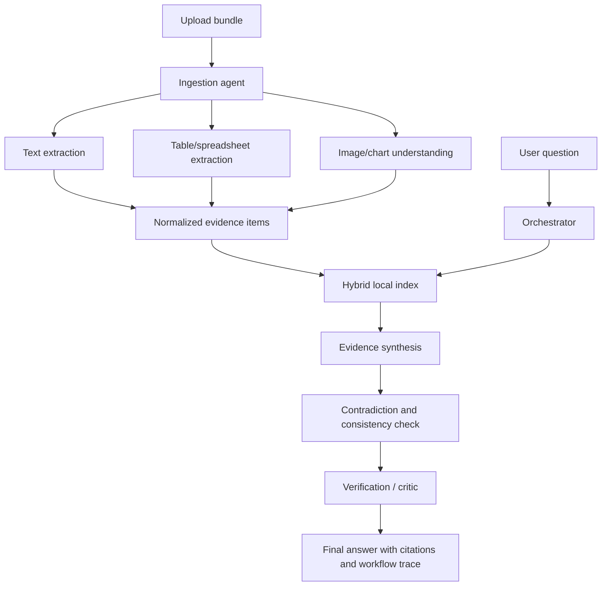

# EvidenceLens architecture

## Overview

EvidenceLens normalizes heterogeneous uploads into provenance-preserving `EvidenceItem` records. A selective orchestrator plans retrieval modes from the question, combines lexical and metadata-filtered retrieval, optionally sends images to an OpenAI-compatible analyzer, synthesizes a cited response, checks numeric consistency, and verifies that evidence exists before formatting the answer.

## Agent responsibilities

- **Ingestion:** validates file types, routes parsers, and records errors without aborting a bundle.
- **Text extraction:** parses Markdown/TXT and PDF pages with stable IDs and page metadata.
- **Table agent:** parses CSV/XLSX rows and retains sheet, row, column, and numeric text.
- **Image/chart agent:** records dimensions and a conservative visual description. Version 0.2 can call an OpenAI-compatible multimodal endpoint and falls back deterministically on timeout, HTTP, configuration, or response errors. Version 0.3 optionally runs bounded local Tesseract OCR and stores OCR text separately; it does not fabricate exact chart values.
- **Retrieval:** deterministic token-overlap ranking fused with a dependency-free hashed-token cosine signal, content-type and metadata filtering, stable tie-breaking, and inspectable score components. The interface can be replaced by a trained embedding/vector store.
- **Orchestrator:** selects only text, table, image/chart, and comparison steps suggested by the query.
- **Synthesis:** builds a response only from retrieved records and attaches citations.
- **Contradiction:** normalizes numeric claims by subject, category, unit, and period/date, then flags comparable mismatches while avoiding false conflicts between different categories, units, or time periods.
- **Verification:** fails no-evidence and missing-citation responses, and lowers trust for uncertain visuals.

## Evidence and citation schema

`EvidenceItem` includes `evidence_id`, source filename/type, content type, text and structured content, page/sheet/row/column provenance, image reference, extraction confidence, retrieval score, and timestamp. Citations reference IDs rather than regenerated source text. This keeps the evidence panel inspectable.

## Failure handling and security

Uploads are copied to a temporary directory using a basename-only filename and unique names for duplicate uploads. Size and extension checks run before parsing. Individual parser failures are returned as errors while other files continue. Uploaded text is never treated as executable instructions; the provider adapter separates a fixed system instruction from image evidence. Secrets are environment-only and are not included in workflow events. Image previews use generated evidence IDs rather than filesystem paths.

## Deployment and tests

The default mock mode is offline and requires no provider key. The FastAPI service exposes `/health`, `/api/upload`, `/api/query`, `/api/evidence`, `/api/evidence/{evidence_id}/asset`, and `/api/reset`, plus a browser UI at `/`. `pytest -q` covers ingestion, provenance, retrieval, selective routing, provider fallback, contradiction handling, safe assets, and API behavior. Docker uses Python 3.13-slim and the pinned requirements file.

## Known limitations

The MVP's visual agent captures metadata and a conservative description; optional Tesseract OCR extracts text but does not digitize chart geometry. Version 0.3's hashed vectors are deterministic semantic-style retrieval, not a trained embedding model. Persistent multi-user storage, authentication, PDF rendering, and audio/video are intentionally deferred.
